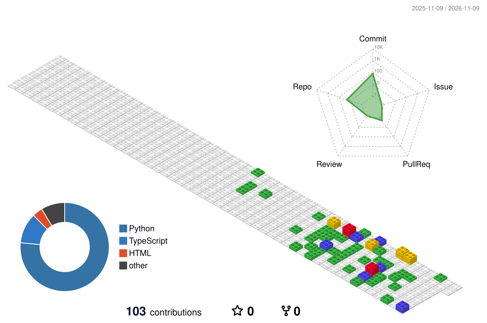

<h1 align="center">Hi, I'm Gary.</h1>

Learning to make better decisions in a changing world.

I'm an undergraduate studying Artificial Intelligence at Nanjing University.

### One contribution at a time

<picture>
  <source media="(prefers-color-scheme: dark)" srcset="https://raw.githubusercontent.com/Gary-CF/Gary-CF/output/github-snake-dark.svg">
  <source media="(prefers-color-scheme: light)" srcset="https://raw.githubusercontent.com/Gary-CF/Gary-CF/output/github-snake.svg">
  
</picture>

<picture>
  <source media="(prefers-color-scheme: dark)" srcset="https://raw.githubusercontent.com/Gary-CF/Gary-CF/output/profile-night-green.svg">
  <source media="(prefers-color-scheme: light)" srcset="https://raw.githubusercontent.com/Gary-CF/Gary-CF/output/profile-gitblock.svg">
  
</picture>

Contribution visuals powered by <a href="https://github.com/Platane/snk">snk</a> and <a href="https://github.com/yoshi389111/github-profile-3d-contrib">github-profile-3d-contrib</a>.

